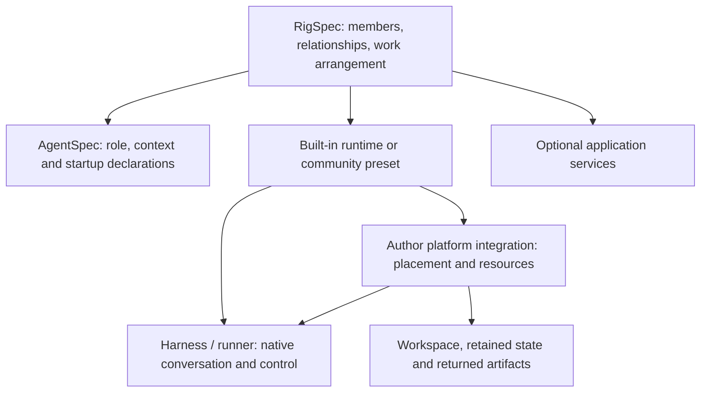

# Integration author contracts — DRAFT for 0.7.6

OpenRig composes agents into a team. An integration author supplies the pieces that let a new harness participate, or let an existing harness run in a new environment. This guide divides that work into two contracts:

1. **[Harness and runner](harness-runner-contract.md):** launch the agent, report its conversation identity and activity, deliver input, handle permission requests and cancellation, and reopen the requested conversation.
2. **[Execution and platform](execution-platform-contract.md):** choose placement, deliver files and credential references, distinguish owned from attached resources, preserve native state, return artifacts and reconcile shutdown.

These are draft author responsibilities. Some use implemented OpenRig interfaces; others describe a proposed integration whose code remains with its author. Including the guide in release documentation does not make every described capability available.

## Candidate and support status

This draft targets the **unsealed 0.7.6 candidate**. Its implemented-interface baseline is commit [`b6bd4633`](https://github.com/mvschwarz/openrig/tree/b6bd4633fbd94634a2b4bdef2574a6880f97be63). That base includes the runner declaration and `passes_model` changes. Later release repairs and version text are still being assembled; no final tag or package publication is asserted here. References below use the immutable base instead of a moving branch.

| Area | Status at this baseline | What the status means |
|---|---|---|
| Community launcher presets, RigSpec members and AgentSpec role/startup declarations | Implemented interfaces | They compose configuration. A launcher must implement its declared effects; successful parsing does not prove delivery or native behavior. |
| `runner: true` with `launch_result: true` | Implemented candidate source | The declaration is retained at launch, and Core uses the runner identity/activity path. It does not supply a runner executable. |
| `passes_model: true` | Implemented candidate source | Passes the declared model through `OPENRIG_MODEL`. It does not observe or verify the effective native model. Cursor and Hermes examples leave it off pending native qualification. |
| The dsh/ACP input, cancellation and refusal-first permission recipe | Proposed author implementation | No end-to-end dsh integration is established. Native reopen capabilities and the tools-off case remain implementer questions. |
| Exact native resume via an author launcher | Existing interface; integration-specific evidence | A requested conversation must reopen exactly or fail honestly. One provider/harness result does not establish portability to another. |
| Environment preparation, projection, artifact export and owned-resource cleanup | Measured in a private wrapper; generic seam proposed | The platform chapter makes the responsibilities reusable. Core does not provide a generic platform driver or `DeploySpec` loader at this baseline. |
| `HarnessSpec`, `DeploySpec`, generic lifecycle fields and wake-on-demand declarations | Proposed vocabulary or unsupported configuration | They are not new accepted YAML keys. Use existing composition and an explicit author implementation. |
| Cross-host native resume, provider-wide cancellation or permission support | Unresolved unless qualified by an integration | Unsupported and untested are distinct from observed failure. Publish the actual boundary and version. |

## How the pieces compose

**RigSpec remains the composer.** AgentSpec describes reusable agent intent; the runtime or preset selects how the native agent starts. An integration can surround that launch with an environment-specific wrapper. A bundled application's database or Compose service is software the team operates; it is distinct from the environment in which an agent executes.

The terminal provider, native harness protocol and network connection also have different jobs. A terminal provider carries input and output; a runner understands native turn boundaries; a granted MCP or other connection exposes coordination operations. An HTTPS connection does not by itself provision compute, awaken a suspended application or establish native resume. Each integration states which of those effects it implements.

| Owner | Responsibility |
|---|---|
| OpenRig Core | Team and work identity, queue records, existing launcher contracts, activity interpretation and declared configuration. |
| Harness/runner author | Native launch and protocol, exact native reference, prompt framing, truthful activity, permission/cancel behavior and native resume. |
| Platform integration author | Placement binding, destination projection, resource ownership, state transfer, artifact delivery and resource reconciliation. |
| Operator / credential owner | Selected environments, grants, provider credentials and spending authority. |

The queue records who owns work. It does not prove that an old provider process has stopped, that a new runtime consumed its history, or that guest bytes reached the consumer. Those observations belong in the launch, resume and export receipts alongside the work record. This division reuses the queue rather than creating another task system.

## Start from an existing example

For a terminal harness, begin with the pinned [community preset reference](https://github.com/mvschwarz/openrig/blob/b6bd4633fbd94634a2b4bdef2574a6880f97be63/docs/reference/community-harness-presets.md) and the [Cursor](https://github.com/mvschwarz/openrig/tree/b6bd4633fbd94634a2b4bdef2574a6880f97be63/docs/reference/community-harness-examples/cursor) or [Hermes](https://github.com/mvschwarz/openrig/tree/b6bd4633fbd94634a2b4bdef2574a6880f97be63/docs/reference/community-harness-examples/hermes) directory. Their presence is source guidance, not an effective-model or complete integration guarantee.

For a structured runner, the [runner chapter](harness-runner-contract.md#2-declare-it-what-the-preset-says-fixed-at-launch) supplies a minimal preset, launch record and activity message. The executable named by the preset must still be implemented and installed by its author.

For a contained worker, the [platform composition](execution-platform-contract.md#a-minimal-composition-using-existing-surfaces) pairs an ordinary coordinator with a worker preset. It uses existing member and preset fields. The wrapper must prepare or attach to the selected environment explicitly; declaring a runtime does not provision it. Its illustrated member list is a fragment, and its launcher is a skeleton, not a ready-to-run provider package.

A rig bundle can carry declarations, roles and supporting scripts. Do not confuse those files with hydrated image layers, installed binaries, registered presets, credentials or live sessions. State what the recipient must supply.

## Lifetime and recovery

**Persistent** and **Non-persistent** describe execution lifetime. A non-persistent invocation has an explicit completion condition tied to its assigned work. **Durable** describes interruption recovery and is independent of that lifetime. An agent can run briefly and still resume its retained conversation later.

Retaining a workspace and reconstruction material can restore useful competence without restoring the same native conversation. Label that as reconstruction. Native resume additionally requires the correct harness-qualified reference and supported native state. The platform chapter's measured example restored copied history into recreated containers on the same host; it does not establish new-host migration or RAM restoration.

## Questions contributors can help resolve

- At a pinned dsh version, which advertised method reopens a session, and can a useful first case run without permission requests?
- Which additional harness would justify a shared protocol runner rather than a separate wrapper?
- Which provider effects can use the existing projection, native-reference and lifecycle dispatch, and which need a new maintained interface?
- What exact state and ownership must travel when compute is recreated or moved?

These questions remain part of the draft. An unanswered contributor thread does not prevent authors from using the implemented interfaces or reviewing the proposed responsibilities. Compatibility claims should name versions, observed behavior and unsupported operations; they should not imply a support guarantee from a manifest alone.
